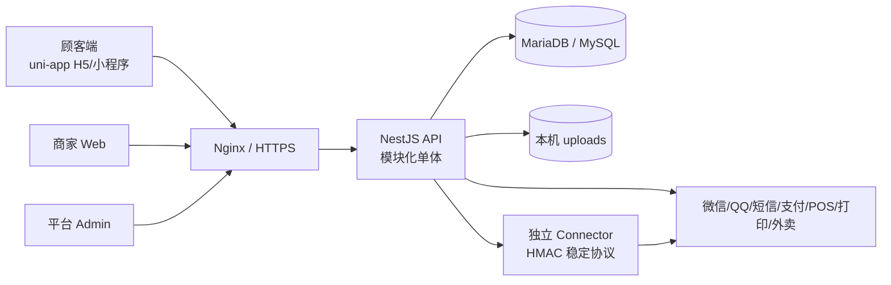
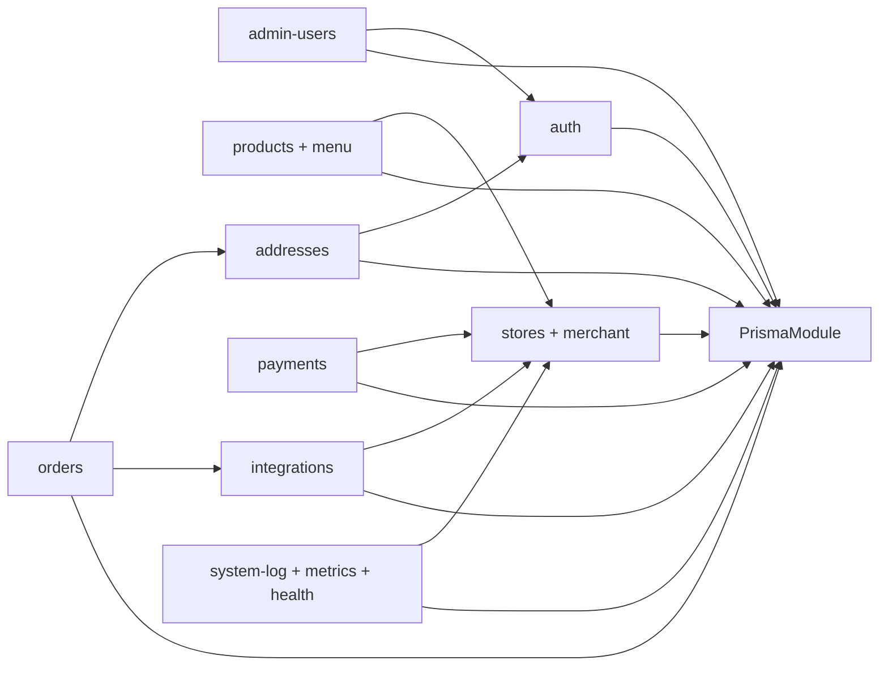
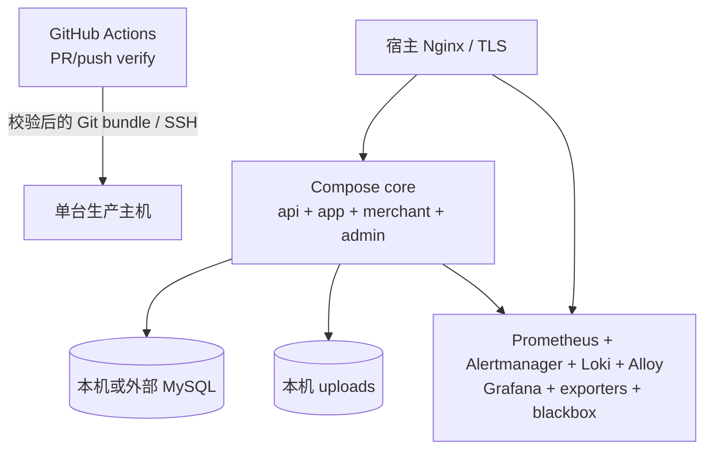

# LingDian 系统结构与架构边界

> 审查基线：2026-08-30；库存和多店运行时增量更新：2026-11-17。本文只描述仓库中已经存在的运行结构；模块成熟度见 [模块目录](./12-module-catalog.md)，上线约束见 [权限与缺口分析](./13-permission-and-gap-analysis.md)，本轮问题与修复证据见 [代码库全面审查](./14-codebase-review-2026-08-30.md)。

## 1. 架构结论

LingDian 是 **pnpm monorepo 下的模块化单体**：顾客端、商家端和平台端共享一套 NestJS API、一个 MariaDB/MySQL 数据库及若干无状态基础包。支付、收银、打印和外卖厂商协议由 Connector 边界隔离，核心 API 不直接依赖厂商 SDK。

当前阶段继续保持模块化单体是合理选择。认证、订单、支付等需要同库事务的领域不应为了形式拆成网络服务；只有出现独立扩缩容、合规隔离、不同发布节奏或明确团队所有权时，才评估拆进程。

产品运行时支持两种模式：

- 默认 `STORE_MODE=single`，所有业务仍限制在 `PRIMARY_STORE_ID`；
- `STORE_MODE=multi` 使用相同数据模型，以门店作为当前租户数据边界；商家授权由活动 MERCHANT/STORE assignment 决定，客户端选店不能扩大范围；
- 两种模式都保留 `PRIMARY_STORE_ID`，作为公开默认入口和启动/readiness 检查；公开菜单可显式指定 storeId，现有顾客前端仍默认主门店；
- Web 顶部统一选择授权门店，商品/订单/收款账户请求使用 `X-Store-Id`，库存/集成路径使用显式门店 ID；多门店账号未选择门店时拒绝业务查询；
- `CLOSED` / `RESTING` 是业务状态，不应让 liveness 失败；下单按请求门店校验营业与服务方式。

## 2. 系统上下文



边界说明：

- 微信、QQ 登录和短信提供方由认证模块调用；
- 支付、POS、打印、美团、京东等通过 Connector 适配；真实厂商 SDK、资质和证书不在本仓库；
- 商品图片写入 API 主机的持久目录，不是对象存储；
- 三个前端生产产物都是静态文件，浏览器和小程序不持有商户密钥或业务授权决策。

## 3. Monorepo 目录与依赖规则

| 路径 | 主要职责 | 可依赖 | 不应承担 |
| --- | --- | --- | --- |
| `uniapp/` | 顾客菜单、规格、购物车、结算、订单、认证、地址 | contracts、icons、observability、common/theme | 商户密钥、服务端定价、权限判定 |
| `web/` | 商家门店工作台、商品配置、订单、原料库存台账、集成开关 | contracts、icons、observability、common/theme | 平台治理、仅靠隐藏按钮授权 |
| `admin/` | 平台账号、系统日志、个人设置 | contracts、icons、observability、common/theme | 商家经营流程、直接访问数据库 |
| `backend/` | HTTP 边界、鉴权、业务规则、事务、状态机、Connector 调度 | db、contracts、common | 页面状态、厂商私有协议实现 |
| `packages/contracts/` | 跨端 API 与事件契约 | TypeScript 标准能力 | Prisma 模型、页面 ViewModel |
| `packages/db/` | Prisma schema、Client、迁移与迁移校验 | Prisma | HTTP DTO、业务用例 |
| `packages/observability/` | 客户端错误上报安装器 | 无业务依赖 | 业务日志查询、告警策略 |
| `packages/icons/` | 三端图标出口 | Vue/Lucide | 页面与业务逻辑 |
| `common/` | 响应码、无状态工具 | 无业务依赖 | 数据库和领域实体 |
| `theme/` | 管理端与小程序设计令牌 | 无业务依赖 | 页面专属布局 |
| `deploy/`、`.github/` | CI、镜像、Compose、Nginx、发布、备份和监控 | Docker/宿主环境 | 真实密钥、业务默认数据 |

依赖方向应保持为：

```text
clients ──> contracts / icons / observability / common / theme
backend ──> contracts / db / common
db、contracts、common ──X──> backend 或任一客户端
```

本轮新增源码门禁会检查生产源文件不超过 600 行，并拒绝相对导入、路径别名和 workspace 包形成的运行时循环依赖。类型导入不计入运行时环。

## 4. 后端模块边界



关键所有权：

- `auth` 拥有身份、会话、验证码、OAuth、法律同意与认证审计；
- `stores` / `merchant` 拥有单/多店解析和商家 scope；
- `products` / `menu` 拥有分类、SPU、SKU、选择组和公开菜单；
- `inventory` 拥有门店原料台账、预警阈值、不可改写的库存流水和按期收支报表；以原料台账为事实来源，按销售规格配方预占并在订单确认/终止时扣减或释放；
- `orders` 拥有服务端报价快照、订单状态与订单 outbox 写入；
- `payments` 拥有支付意图、资金流水和验签回调；订单只有在支付域确认资金事实后进入在线 `PAID`；
- `integrations` 拥有可选 Connector 开关、可靠投递和重试；
- `system-log`、`metrics`、`health` 分别负责应用日志、Prometheus 指标与存活/就绪检查。

## 5. 核心数据流

### 5.1 认证与会话

1. 顾客使用手机号/微信/QQ，商家和平台使用账号密码；
2. API 按 `user-api`、`merchant-api`、`admin-api` audience 签发会话；
3. 每次登录创建新的 session ID，同设备已有活动会话被撤销，数据库保证每设备最多一条活动会话；
4. H5 通过 `HttpOnly` cookie 轮换 refresh token 并检测重放；微信/QQ 小程序不依赖 cookie 持久化，而是用新的 `uni.login` 平台码为已绑定且启用的 `USER` 身份创建新 session；显式退出或服务端拒绝后会阻断自动恢复；
5. 受保护请求同时校验 JWT、数据库 session、用户状态和 `sessionVersion`。

### 5.2 菜单、规格与下单

1. 顾客读取 `/api/menu/current`，服务端解析显式或默认门店；匿名 GET 不写演示数据；
2. 顾客端按默认活动 SKU 展示商品，并支持选择组的单选/多选、必选/可选和 min/max；
3. 购物车当前只在客户端内存中保存；
4. 下单时 API 重读门店、SKU、选择组、选项和地址，以整数分重新计价；
5. 订单、明细、选择快照、状态日志和可选 `order.created` outbox 在同一事务写入；
6. 已配置原料配方的规格按可用量校验和预占；旧 SKU 库存数仍是维护字段，优惠券未参与计价。

### 5.3 支付

1. 顾客只能为自己、运行模式允许且未删除的待支付订单创建幂等意图；
2. 数据库 `activeOrderKey` 保证一个订单最多一个活动支付尝试；订单终止、支付预占、成功确认和过期释放都遵守 order → intent 锁顺序；
3. Connector 同步响应只表示创建受理，不能直接成为支付成功事实；
4. Connector 验证厂商事件后，以 HMAC 回调 API；
5. API 核对账户、提供方、金额、币种、外部意图和事件幂等，并在事务中写 PaymentIntent、PaymentTransaction、Order 与状态日志；成功回调与取消串行化，乱序 `PROCESSING` 不会复活失败意图，迟到成功进入 `LATE_PAYMENT` 处置；
6. 过期活动意图不会仅按本地时间释放；新尝试前必须从 Connector 获得按 `payment_no` 串行化、带持久关单凭证的 `CLOSED` 结果，否则继续占用并进入人工核对；
7. 在线订单不能由通用订单接口手工标记 `PAID`、`REFUNDING` 或 `REFUNDED`。

该服务端底座仍未形成顾客端真实支付、退款、主动查单、定时超时 worker 和对账闭环，详见 [支付交易与订单模块设计](./10-payment-order-architecture.md)。

### 5.4 外部集成

1. 订单事务按部署级和门店级开关写 `integration_outbox`；
2. API 内轮询器原子认领，失败指数退避，最多 8 次后进入死信；
3. Connector 将稳定事件翻译成 POS、打印或外卖平台协议；
4. 当前只有 `order.created` 出站事件，没有入站状态、死信运营界面或人工重放入口。

## 6. 信任与数据边界

| 边界 | 服务端必须重新校验 | 当前状态 |
| --- | --- | --- |
| 顾客端 → API | audience、用户归属、门店、SKU/选项、价格、地址、订单状态 | 主链已校验；真实支付与优惠未闭环；配方原料库存已接预占/扣减/释放 |
| 商家端 → API | `MERCHANT`、已授权门店 scope、对象归属、领域状态 | 门店 scope 已实现；动作级权限缺失 |
| 平台端 → API | 管理层级、目标账号层级、敏感动作 | 固定角色和层级有效；商品/订单仍是宽 `ADMIN` |
| API → DB | 事务、唯一约束、条件更新、状态日志 | 核心交易具备事务/条件更新；统一业务审计仍缺 |
| API → Connector | HTTPS URL、HMAC、超时、幂等、重试 | 出站主链已实现；死信运营与双向事件缺失 |
| Connector → API | raw body、时间戳、nonce、签名、账户与资金字段 | 支付回调底座已实现；真实厂商 E2E 未验收 |
| 客户端 → 日志 | source/audience、速率、大小、脱敏 | 已有限流和脱敏；缺跨服务 trace |

## 7. 运行、发布与可观测性



仓库内已有的发布保障：

- PR、`main` push 和手动触发共用 verify；PR 不执行生产 deploy；
- verify 使用 MySQL 8.4 空库完整重放 Prisma 迁移，并运行部署契约、测试、类型检查、构建、Dockerfile/Compose 和脚本语法校验；
- 发布使用校验过的不可变 Git bundle 和完整 SHA；生产 job 绑定 GitHub `production` environment；
- 默认迁移前备份数据库与 uploads；迁移前先停止 API 写入，迁移失败时核心服务保持停止，等待 roll-forward 或恢复已验证备份；
- `api + app + merchant + admin` 作为一组激活和健康检查；激活失败时只有上一 release 与目标 release 的完整 Prisma 迁移树逐字节一致才自动恢复，否则停止核心服务并要求人工处置；
- liveness 与 readiness 分离，readiness 校验数据库和主门店；
- 完整观测栈包含 API/主机/容器指标、集中日志、公网探测、dashboard、告警和保留策略；Grafana、Prometheus、Alertmanager 只绑定 `127.0.0.1`，公网 `/api/metrics` 被 Nginx 阻断。

仍然存在的运行边界：

- 单主机仍是故障域，数据库和 uploads 的默认备份也在本机；必须异机复制并做恢复演练；
- uploads 是本机目录，不具备对象存储的多副本与跨主机恢复能力；
- 应用回滚不会自动反向执行数据库迁移，迁移历史不完全一致时会在激活前拒绝且保持当前服务不变；需要依靠 expand/contract、roll-forward 和经演练的备份恢复；
- 同机监控无法发现整机断电，仍需异地 uptime 探测；
- readiness 尚未覆盖迁移漂移、上传盘空间和所有 Connector。

生产操作以 [部署 Runbook](../deploy/README.md) 和 [可观测性说明](../deploy/observability/README.md) 为准。

## 8. 架构守则

1. 金额、权限、订单状态、库存和退款事实以服务端实现与数据库不变量为准。
2. Controller 做协议和身份边界；service 做领域规则；Prisma 查询必须携带 owner/store scope。
3. 幂等快捷路径不得位于对象授权之前；并发不变量优先落数据库唯一键或条件更新。
4. 运行时依赖只能沿既定方向流动，不用 barrel 文件形成互相引用。
5. 生产源码单文件默认不超过 600 行；超过阈值应按查询、命令、策略、映射或组件拆分。迁移、schema、声明式配置和测试按可读性单独评估。
6. 静态页面不能以模拟数字伪装真实能力；未闭环模块默认 feature flag 关闭。
7. 任何新模块必须同时补契约、鉴权、异常语义、测试、模块目录和上线风险说明。
8. 迁移只前向演进；发布前备份不能替代隔离恢复演练和向后兼容设计。

## 2026-11-17 库存增量

新增 `InventoryModule` 和 `/merchant/stores/:storeId/inventory`：所有入口先验证 merchant audience/角色，再由 `MerchantStoreScope` 校验服务端授权门店。原料和流水均保留 `storeId`；流水通过 `(itemId, storeId)` 复合外键引用原料，阻止跨门店关联。原料台账初版沿用单店 resolver；后续多店运行时见下节。

数量按单位的千分之一保存为整数，API 返回至多三位小数；新增原料初始为零。入库、出库、盘点和阈值变更使用版本条件更新，并在同一事务插入 actor/reason/before/after 流水。`storeId + requestId` 唯一键约束幂等，重放也先做 scope 检查。列表、计数和流水分页采用一致快照；预警按零库存优先、正库存小于等于阈值为低库存计算。

实现与验收边界见 [库存迭代记录](./15-inventory-iteration-2026-11-17.md)。

## 2026-11-17 多店运行时增量

`StoresModule` 根据配置创建一个 resolver 实例，保留单店行为并支持多店。商家 API 在对象查询之前核对所选门店与签名会话的授权集合；多店商家不再默认混查所有已授权门店。顾客订单查询按 owner 覆盖自身所有门店订单，支付查询先确认 owner，再以订单门店找到收款账户；验签 webhook 仍核对 account、order.storeId、金额和外部引用。多店 outbox 轮询与遗留认领恢复覆盖所有门店。

Web 门店选择按账号和标签页保存，退出清除、授权变更剔除失效选择。业务页面以门店 ID 为 key 重建，表单草稿和异步响应不跨店复用；401 重试固定原请求门店。具体范围见 [多店迭代记录](./16-multi-store-iteration-2026-11-17.md)。

## 2026-11-17 库存分析与报表增量

新增明确损耗 `LOSS`，与出库一样检查正数量、可用库存和版本，并在同事务记录原因、前后值及幂等键。明细支持日期、操作类型和原料筛选；`GET /merchant/stores/:storeId/inventory/report` 在单个 RepeatableRead 快照内读取原料并聚合不可变流水，以起始时刻之前的净变动为期初、结束时刻之前为期末，区分入库、出库、损耗和盘盈盘亏。不同原料/单位分别核算，不做无意义的混合合计。

日期在 API 中为带时区的明确时刻，采用左闭右开区间；Web 按浏览器本地日期生成边界并显示时区，链接保存规范化时刻及筛选。报表表格分页只裁剪当前快照，完整 CSV 导出同一快照的全部行。支持最大 366 天、10,000 种原料；超限返回错误，不静默截断。详见 [库存报表迭代记录](./17-inventory-reports-2026-11-17.md)。


## 2026-11-17 订单原料预占增量

`OrderStockService` 由订单、支付模块显式注入，在调用方事务内处理原料预占、付款扣减与终止释放。销售配方绑定 SKU；引用规格配方追加计算，空配方沿用人工运营。下单固定原料用量快照，后续修改不追溯已下单订单。所有数量使用整数千分量，锁顺序为订单 → 排序 SKU → 排序原料，事务使用 ReadCommitted。物理量 = 预占量 + 可用量受 MySQL CHECK 保护。

库存列表和预警基于可用量；区间收支仍基于物理量，预占/释放计入记录数但不影响出入库数量。配方写入审计，原料流水保留订单号、actor 和预占前后值。30 分钟预占到期后，worker 先验证支付关单，再尝试事务终止订单；支付未明确关闭时保留原料。退款不自动回补已消费原料。实现与隔离 MySQL 证据见 [订单库存迭代](./18-order-inventory-2026-11-17.md)。


## 2026-11-17 站内预警增量

`InventoryAlert` 记录每次持续短缺的发现快照、最新可用量/阈值、跟进与解除状态。原料创建/调整以及订单库存变动在原事务内同步预警，nullable active key 保证同原料最多一个活动事件；缺货升级重新待跟进，可用量超过当前阈值自动解除。确认跟进沿用原料 → 预警锁顺序并校验版本，同事务写审计，不改变库存。商家顶栏按当前门店轮询待跟进数，库存页提供筛选、跟进、历史与当前页 CSV。详见 [预警中心](./19-inventory-alerts-2026-11-17.md)。


## 2026-11-17 经营与占用运营增量

商家工作台通过 `MerchantDashboardService` 提供期间订单/有效成交、服务方式、状态与前 10 规格快照，另列不限日期的当前预警/待履约/到期占用。门店内查询采用 RepeatableRead，排行用绑定参数 SQL；金额为订单口径的 CNY 应付金额，不是现金实收或利润。`StockHoldService` 属于 orders 模块，按门店列出预占，并复用支付关单验证和订单事务处理到期占用，没有强制释放路径或 inventory→orders 反向依赖。见 [经营与占用迭代](./20-merchant-operations-2026-11-17.md)。


订单查询增量：商家订单页使用 URL 编码已查询条件和详情 ID，切店清除详情并使旧响应失效。新查询使用 startDate（含）+ endBefore（不含），旧 endDate 继续包含；汇总在 RepeatableRead 中按完整筛选分组，不覆盖状态条件。中英文、手机卡片和现金/终止/删除确认见 [订单交互迭代](./21-order-workflow-2026-11-17.md)。

### 商品配置版本与多语言维护

商家商品页提供中英文、URL 筛选与详情、桌面表格/手机卡片、原生配置表单。商品配置写入先按门店验证，再以 `configurationVersion` 条件更新认领版本，顺序锁定既有 SKU、更新选择组/选项、刷新汇总并在同一事务写审计。移除规格只停用，保留配方和订单历史；同商品新规格的临时 ID 可用于选择组绑定。跨商品共享组在编辑当前商品时复制，避免影响其他商品。平台旧写入允许省略版本，但每次递增版本使商家旧草稿失效。参考数量不参与订单原料承诺。新增迁移需先于新 API 部署，详见 [商品配置迭代](./22-product-catalog-2026-11-17.md)。

### 采购与原料入库

库存模块内的 purchasing 服务承接供应商、采购单、分批收货及取消剩余。store scope 和复合外键保持租户边界，创建/收货使用请求指纹幂等，版本认领后读取最新明细，按原料 ID 顺序锁定。收货、原料数量/可用量、RECEIVE 流水、预警和业务审计在同一事务提交；库存报表复用台账，流水可追溯采购单。金额按批次行以整数分记录，不构成付款或库存估值。见 [采购迭代](./23-purchasing-2026-11-17.md)。

### 收货分析与补货判断

采购分析服务按收货时间读取已记录的行金额，并在同一 RepeatableRead 快照内汇总供应商/原料和去重批次；未收采购按当前 OPEN/PARTIAL 行计算，仅用于阈值补货建议，不加入现货可用量。两个完整快照接口均先检查门店，限制 10,000 条并拒绝溢出，CSV 不从可见分页取数。新增查询索引与验证见 [采购分析](./24-purchasing-analysis-2026-11-17.md)。

### 商家账号和语言一致性

商家工作台统一头部语言选择，公开账号页复用同一偏好；标题与 HTML lang 同步。系统设置收拢个人昵称/改密和当前门店集成开关。昵称 GET/PATCH 以当前认证用户为范围；集成能力/更新验证门店，写入和身份审计原子提交。细节和语言边界见 [账号与设置](./25-account-settings-2026-11-17.md)。

### 商家商品生命周期

商家可在授权门店建分类、幂等创建商品草稿、按版本维护基本资料和确认发布/下架。发布校验可见分类、活动规格和默认规格的可用必选项，既有下单继续服务端校验；状态/资料与审计原子提交，规格与配方保持原身份。创建请求索引和描述 TEXT 迁移见 [商品建档与发布](./26-merchant-catalog-2026-11-17.md)。

采购补货增量：汇总与采购单追查共用当前门店、OPEN/PARTIAL 订单和行未收齐条件，数据库列间比较排除混合采购单中已完成的原料。预警/库存按原料 ID 定位建议，未收采购列表可继续登记收货；切店清理对象范围。见 [补货追查](./27-replenishment-follow-through-2026-11-17.md)。

盘点单增量：库存模块增加独立 stocktakes 服务和授权门店 API。草稿保存快照/实盘，单据版本串行化写入，过账按原料 ID 顺序 CAS 核对库存版本并同步 COUNT 流水、预警与审计；任一失败整单回滚。复合外键保留租户边界，历史流水新增可空来源关联。见 [盘点单](./28-stocktakes-2026-11-18.md)。

分类维护增量：商家分类列表提供店内商品统计，改名/排序/展示在门店锁、分类版本与审计事务下维护。旧平台修改递增分类版本；顾客菜单的商品关联补齐当前门店条件，保留原有展示语义。新增版本迁移与验证见 [分类管理](./29-category-management-2026-11-18.md)。

商家图片增量：按门店/商品范围接收 Multipart，在解码优化、持久化请求归属和文件就绪后，以商品版本/审计事务更新引用；幂等重试和过期清理收敛未完成文件，已提交历史资产保留。前端域名的商品媒体路径代理到 API，复用 uploads 挂载/备份。见 [商品图片](./30-product-images-2026-11-18.md)。
